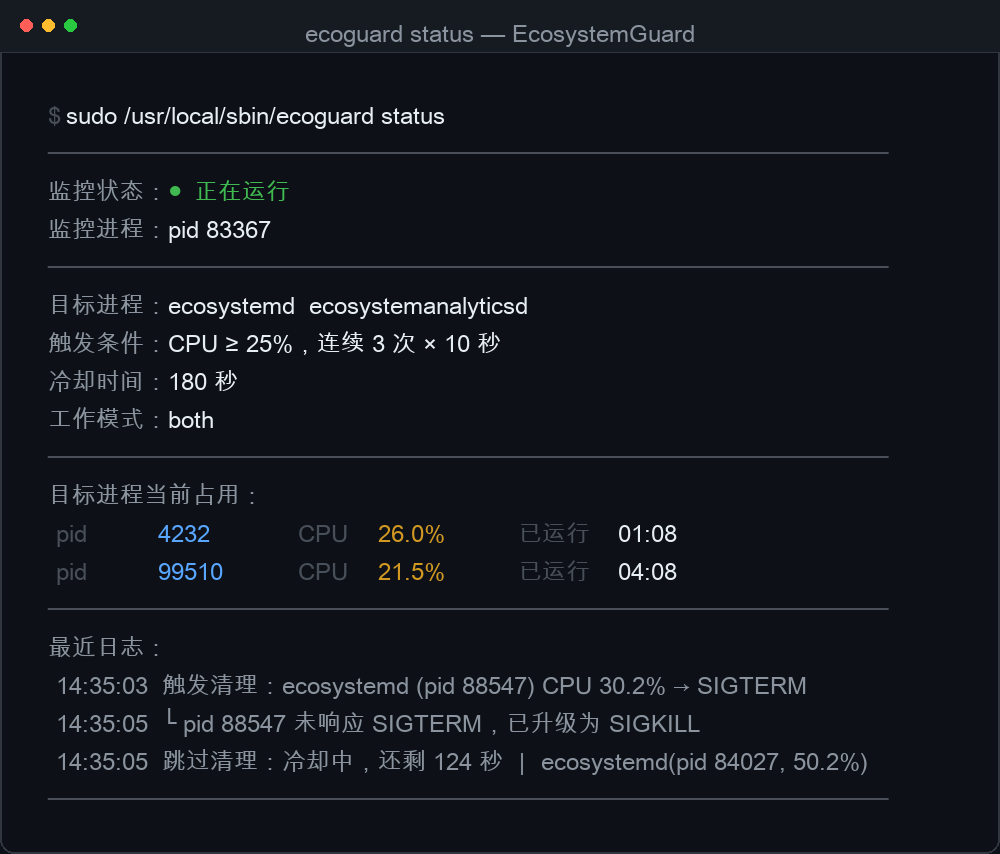

# EcosystemGuard

**macOS 上针对高 CPU 后台守护进程的监控与自动清理工具。**

当 `ecosystemd`、`ecosystemanalyticsd` 这类由 `launchd` 托管的系统服务突然吃掉 30%–50% CPU、导致机器卡顿时，它会按阈值自动清理，并以 LaunchDaemon 常驻、开机自启，同时提供一键停止。

**English**: A lightweight LaunchDaemon watchdog for macOS that samples CPU usage of configured processes and terminates the ones that stay above a threshold. Handles the "kill it and it comes right back" problem that `launchd`-managed daemons have. See [English summary](#english) at the bottom.



---

## 背景：为什么手动退出没用

截图里这两个进程不是第三方软件，而是 macOS 自带的系统服务：

| 进程 | 路径 | 身份 |
|---|---|---|
| `ecosystemd` | `/System/Library/PrivateFrameworks/Ecosystem.framework/Support/ecosystemd` | root |
| `ecosystemanalyticsd` | `/System/Library/PrivateFrameworks/EcosystemAnalytics.framework/Support/ecosystemanalyticsd` | root |

它们由 `/System/Library/LaunchDaemons/*.plist` 注册给 `launchd`，并声明了 Mach 服务（按需唤醒）。所以在活动监视器里「强制退出」之后，只要有系统组件调用它们，`launchd` 就会立刻重新拉起——这就是「清掉后过一会又出现」的原因。

在实机上连续采样两分钟可以确认这不是错觉：`ecosystemd` 长期在 30%–52%，`ecosystemanalyticsd` 在 21%–43%，PID 反复变化。原始数据见 [docs/measurements.md](docs/measurements.md)。

## 工作原理

```
每 10 秒采样一次 ps
      ↓
连续 3 次 ≥ 25%  →  判定为失控（约 30 秒，过滤瞬时尖峰）
      ↓
先 SIGTERM，2 秒后仍在则 SIGKILL
      ↓
尝试 launchctl disable + bootout（阻止 launchd 再拉起）
      ↓
进入 180 秒冷却，每小时最多 12 次
```

监控本身也是一个 LaunchDaemon（`com.local.ecosystemguard`），`RunAtLoad` 开机自启；正常停止后不会被 `launchd` 复活。

## 安全设计

| 机制 | 作用 |
|---|---|
| **保护名单** | `WindowServer`、`kernel_task`、`launchd`、`Dock`、`Finder` 等永久排除。杀掉 `WindowServer` 会直接黑屏/强制注销 |
| **持续判定** | 必须连续 N 次超阈值才动手，瞬时尖峰不会误杀 |
| **限流** | 冷却时间 + 每小时上限，防止「杀了又被拉起、再杀」的空转反而拖慢机器 |
| **精确匹配** | 只对比进程名（`comm` 的最后一段），不做模糊匹配 |

## 环境要求

- macOS 12 或更新（在 macOS 27 上实测）
- 管理员账户（安装时输入一次开机密码）
- SIP 开启也能用，见 [已知限制](#已知限制)

## 安装

**方式一（推荐）**：双击 `安装.command`，在弹出的系统密码框里输入开机密码。

**方式二**：命令行

```bash
./install.sh      # 注意：不要加 sudo，脚本会自己提权
```

脚本会把整个目录复制到 `/tmp` 再以管理员身份执行，以此绕开 macOS 对「桌面 / 文稿」目录的隐私保护（root 读不到那些目录）。

**方式三**：拖拽 `.dmg` 里的 `EcosystemGuard.app` 到「应用程序」，打开后点「安装」。
镜像需要自己构建（仓库不存放二进制）：

```bash
./app/build.sh          # 生成 app/build/EcosystemGuard.app 和 EcosystemGuard-1.0.0.dmg
```

## 图形界面（.app / .dmg）

构建后得到两个 App，都由 `osacompile` 编译（不需要 Xcode）：

### `EcosystemGuard.app` —— 控制面板

| 位置 | 内容 |
|---|---|
| 主窗口 | 运行状态、累计清理次数、最近一次清理、两个进程的当前 CPU |
| 更多操作 → 查看完整统计 | 按进程 / 按日期的条形图 |
| 更多操作 → 查看最近日志 | 最近 30 行日志 |
| 更多操作 → 停止 / 启动 / 重启监控 | 免密执行（走 `ecoguard`） |
| 更多操作 → 卸载监控 | 确认后卸载并恢复系统服务 |

### `EcosystemGuardMenu.app` —— 菜单栏常驻

一个 `LSUIElement` 应用（不占 Dock、不进 Cmd+Tab），用 AppleScriptObjC 创建 `NSStatusItem`：

- 菜单栏显示 `🛡 累计次数`，每 8 秒刷新一次；监控停止时变成 `🛡 N ⏸`
- 点开菜单：累计清理次数 / 打开控制面板 / 停止（启动）监控 / 开机自启 / 退出
- 勾上「开机自启」会写一个 `~/Library/LaunchAgents` 登录项，之后每次登录自动出现

### 安装包自带载荷

控制面板的 bundle 里带着完整的 `payload`（`install.sh` + 脚本 + plist），所以**即使没克隆仓库也能用它一键安装**。

关于「开机自启」，其实是三件事：

- **监控服务**：由 LaunchDaemon 保证，`RunAtLoad`，开机即运行，**不需要任何 App 常驻**；
- **菜单栏数字**：勾选状态栏 App 的「开机自启」（写 LaunchAgent），登录即显示；
- **控制面板**：只是按需打开的工具，不需要自启。

App 用 ad-hoc 签名。如果你自己再分发，别人首次打开可能需要在「系统设置 → 隐私与安全性」里点「仍要打开」。

## 使用

| 双击 | 作用 |
|---|---|
| `安装.command` | 安装并立即启动 |
| `停止监控.command` | 停止监控，且下次开机不再自启 |
| `启动监控.command` | 重新开启监控 + 恢复开机自启 |
| `重启监控.command` | 修改 `config.conf` 后重启生效 |
| `查看状态.command` | 运行状态、当前 CPU 占用、累计清理次数、最近日志（无需密码） |
| `查看统计.command` | 累计清理次数，按进程 / 按日期画条形图（无需密码） |
| `查看日志.command` | 最近 40 行日志（无需密码） |
| `卸载监控.command` | 彻底卸载并恢复系统服务 |

命令行等价写法：

```bash
sudo /usr/local/sbin/ecoguard status
sudo /usr/local/sbin/ecoguard stats       # 累计清理统计
sudo /usr/local/sbin/ecoguard stop
sudo /usr/local/sbin/ecoguard start
sudo /usr/local/sbin/ecoguard restart
sudo /usr/local/sbin/ecoguard log 100
sudo /usr/local/sbin/ecoguard restore    # 恢复被禁用的系统服务
sudo /usr/local/sbin/ecoguard uninstall
```

安装时会在 `/etc/sudoers.d/ecoguard` 写入一条规则，只对 `ecoguard` 这一个脚本的 `start/stop/restart/status/log` 免密，其他命令仍然需要密码。

## 查看清理统计

每次真正执行清理时，`monitor.sh` 会往 `/Library/Application Support/EcosystemGuard/kills.log`
追加一行记录（时间、进程名、pid、当时的 CPU%）。这个文件独立于日志滚动，不会被轮转掉，
所以累计数字是完整的。

`ecoguard stats`（或双击 `查看统计.command`）会把它汇总成：

```
──────────────────────────────────────────────
  累计清理：60 次
  最近一次：2026-10-21 16:19:36  ecosystemd (pid 36070)  CPU 60.3%
──────────────────────────────────────────────
  按进程：
    ecosystemd                 41 次  ████████████████████
    ecosystemanalyticsd        19 次  █████████
──────────────────────────────────────────────
  按日期：
    2026-10-20                 18 次  ████████████████████
    2026-10-21                 42 次  ██████████████████████████
──────────────────────────────────────────────
  记录文件：/Library/Application Support/EcosystemGuard/kills.log
```

首次安装（或从旧版本升级）时，`install.sh` 会把历史日志里已有的清理记录一次性迁移进
`kills.log`，所以数字不会从 0 开始。

## 配置

安装后配置文件在 `/Library/Application Support/EcosystemGuard/config.conf`（源码模板见 [config/config.conf.example](config/config.conf.example)），改完双击 `重启监控.command` 生效。

| 参数 | 默认 | 说明 |
|---|---|---|
| `TARGET_NAMES` | `ecosystemd ecosystemanalyticsd` | 要监控的进程名 |
| `DENY_NAMES` | `WindowServer kernel_task …` | 永不触碰的进程 |
| `THRESHOLD` | `25` | CPU 百分比阈值 |
| `INTERVAL` | `10` | 采样间隔（秒） |
| `SUSTAIN` | `3` | 连续几次超阈值才动手 |
| `COOLDOWN` | `180` | 一次清理后的冷却时间（秒） |
| `MAX_KILLS_PER_HOUR` | `12` | 每小时清理上限 |
| `MODE` | `both` | `kill` 只清理 / `disable` 只禁用服务 / `both` 两者都做 |

## 已知限制

SIP（System Integrity Protection）开启时：

- `launchctl disable system/com.apple.ecosystemd` **可以生效**，会把服务标记为禁用；
- `launchctl bootout system/com.apple.ecosystemd` **会被拒绝**：

  ```
  Boot-out failed: 150: Operation not permitted while System Integrity Protection is engaged
  ```

因此对于**已经加载在 launchd 里的实例**，杀掉之后仍可能被重新拉起，程序会按冷却与每小时上限反复清理；而 `disable` 标记在重启后会生效，届时这些服务大概率就不再自动启动，监控退化为兜底。

这不是本工具的缺陷，而是系统的硬限制，同类工具（例如 [RemoveMacAI](https://github.com/omlahore/RemoveMacAI)）也明确说明无法批量停用 Apple 的后台服务。

另外两个必须知道的点：

- **杀 `WindowServer` 会导致黑屏 / 强制注销**，保护名单里已经固定排除，不要手动加进目标。
- 普通用户**无法**对 root 进程发信号（`kill: Operation not permitted`），所以这类工具必须以 LaunchDaemon 的身份运行——这也是绝大多数菜单栏 App 类工具做不到这件事的原因。

## 卸载

双击 `卸载监控.command`，或：

```bash
sudo /usr/local/sbin/ecoguard uninstall
```

会移除 LaunchDaemon、`/usr/local/sbin/ecoguard`、`/Library/Application Support/EcosystemGuard`、`/etc/sudoers.d/ecoguard`，并把两个 Apple 系统服务恢复为默认状态。日志 `/var/log/ecosystemguard.log` 保留，可手动删除。

## 目录结构

```
.
├── install.sh                          # 安装（自动提权）
├── 安装.command / 停止监控.command …    # 双击入口
├── scripts/
│   ├── monitor.sh                      # 监控主程序（由 launchd 常驻）
│   └── ecoguard                        # 控制台（start/stop/status/…）
├── launchd/
│   └── com.local.ecosystemguard.plist  # LaunchDaemon 定义
├── config/
│   └── config.conf.example             # 配置模板
├── app/
│   ├── EcosystemGuard.applescript      # 控制面板源码
│   ├── EcosystemGuardMenu.applescript  # 菜单栏 App 源码（AppleScriptObjC）
│   ├── resources/summary.sh            # 弹窗用的状态摘要
│   ├── resources/menubar.sh            # 菜单栏刷新用的三项数据
│   ├── resources/loginitem.plist.template
│   ├── icon.png                        # 1024px 图标源文件
│   └── build.sh                        # 构建两个 .app 与 .dmg（无需 Xcode）
└── docs/
    └── measurements.md                 # 实机采样记录与 SIP 证据
```

安装后的运行位置：

| 内容 | 路径 |
|---|---|
| 主程序 | `/Library/Application Support/EcosystemGuard/monitor.sh` |
| 配置 | `/Library/Application Support/EcosystemGuard/config.conf` |
| 控制台 | `/usr/local/sbin/ecoguard` |
| 开机自启 | `/Library/LaunchDaemons/com.local.ecosystemguard.plist` |
| 日志 | `/var/log/ecosystemguard.log` |
| 清理统计 | `/Library/Application Support/EcosystemGuard/kills.log` |

## English

A small LaunchDaemon watchdog for macOS that samples CPU usage of configured processes every 10 seconds and terminates any that stay above a threshold for N consecutive samples. It targets the "I quit it and it keeps coming back" class of `launchd`-managed daemons (e.g. `ecosystemd`, `ecosystemanalyticsd`), which respawn on demand.

- SIGTERM first, SIGKILL after 2 s; cooldown and hourly cap to avoid a kill-loop.
- Hard deny-list (`WindowServer`, `kernel_task`, `launchd`, …) so system-critical processes are never touched.
- Optionally attempts `launchctl disable` / `bootout` — note that `bootout` is refused while SIP is enabled.
- Installs as a LaunchDaemon (`RunAtLoad`), with a small `ecoguard` CLI and double-clickable `.command` files to start/stop it.

Must run as root: a normal user cannot signal root-owned processes. Install with `./install.sh` (it escalates via the standard macOS auth dialog).

## License

[MIT](LICENSE)
